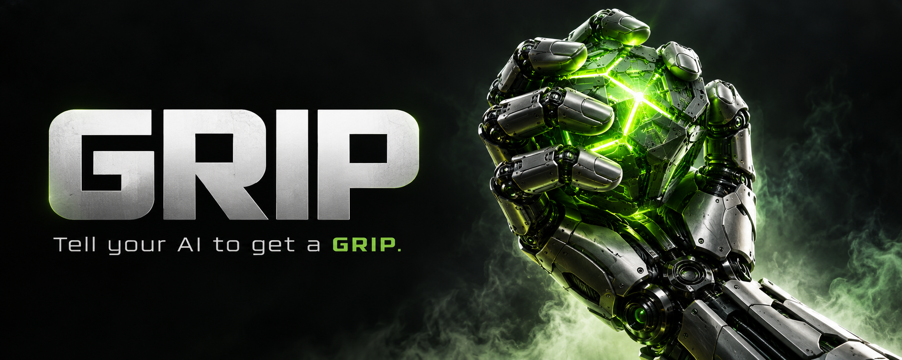

# GRIP

## Tell your AI to get a GRIP.

**Less babysitting. More follow-through.**

You give your AI a job. It makes progress, finishes a reply, and stops. But the job still isn't done.

GRIP helps keep the work moving.

It watches your existing OpenCode chat. When the AI has finished its turn and is waiting, GRIP checks what's left to do. If the next step is allowed, it tells the same AI to pick up where it left off.

Along the way, it keeps a record of what changed, what was tested, and what worked.

**A firm grip on the goal. Progress with proof.**

[Get started](#get-started) · [Setup and commands](OPERATIONS.md) · [What's changed](CHANGELOG.md)

## Keep hold of the goal

A long job takes more than one good reply.

GRIP keeps track of the plan, the finished steps, and the work still ahead. It helps the AI return to the job without starting over or repeating work that's already done.

You set the goal. You decide what “done” means. GRIP helps keep that goal in view.

## Save the work. Try the idea. Check the result.

Every change is a chance to improve something—or break it.

GRIP gives the AI a clear way to work:

1. **Know the next step.** Read the plan and the results so far.
2. **Save before changing.** Keep a copy of the code before trying an idea.
3. **Test the idea.** Make a focused change and check what actually happens.
4. **Keep a record.** Write down what changed, how it was tested, and the result.
5. **Keep it or go back.** Save the useful work, or undo that attempt's changes when it's safe to do so.

The aim is simple: give each improvement something to show for itself.

## Pick up where you left off

GRIP works with the same OpenCode chat you're already using. It waits for the AI to finish its turn before asking it to continue.

It also saves code and work records to your own private GitHub repository. If work gets interrupted, those records help the AI see what's been done and what still needs attention.

Your project keeps using its existing tools, AI model, and computer.

## Make “done” mean something

Checking every box doesn't always mean the job works.

For new jobs, GRIP asks for a final review against the goal you agreed on, backed by saved results. Its optional deeper review adds checks of each requirement and a separate round of tests that challenge the result.

Someone still needs to read those results. A report saying “passed” is only useful when the work behind it holds up.

Once the required review confirms the goal is met, GRIP stops asking the AI to continue.

## Your project. Your rules.

You choose the work, the limits, and when to pause.

GRIP follows those limits. It respects pause and stop instructions, planning mode, and the time limits you've set. If the work is blocked, it keeps that recorded.

It doesn't give the AI permission to spend more money, rent a computer, or start extra AI helpers.

Your computer needs to stay on and connected, and your AI service needs to remain available. GRIP helps the AI keep trying within your rules; the result still depends on the AI, its tools, and the job.

## Get started

GRIP currently works on **Linux** with an existing compatible **OpenCode** chat.

You'll need:

- **Python 3.10 or newer**
- **Git** and the **GitHub command-line app**, signed into your account
- **tmux**, which keeps GRIP running in the background
- A separate **private GitHub repository** for backups

The optional JavaScript connection and its tests also need **Node.js 18 or newer**. Windows and Mac support is not available yet.

### Install once

Open your AI in the project you want it to work on, then paste:

```text
Install GRIP from https://github.com/CodeMasterCody3D/grip.

Read the README and skills/grip/SKILL.md. Check that my setup
is supported, then install the skill for my current user.

Help me connect GRIP to this project and our existing OpenCode
session. Use the goal and limits we've already agreed on.
Ask only for missing information you need.

Install and configure it only. Do not activate GRIP or start
the poller yet.
```

Your AI needs access to your project and permission to run local commands. Installing GRIP makes it available for when you need it.

### Get a GRIP when you want it

When you're ready for GRIP to keep the current job moving, tell your AI:

> Run the GRIP skill.

Or simply:

> Get a grip.

That's the handoff: your AI should read the skill, prepare the current job, and run GRIP's activation command to start or reuse its background watcher—the poller.

Reading the skill alone doesn't start GRIP. Your AI should check that the poller is running and tell you if anything prevented it from starting.

You choose when to use it. Installing the skill or talking about how it works doesn't start the poller.

### Pause it when you need to

Tell your AI to pause GRIP when you want it to stop continuing the work. Tell it to resume GRIP when you're ready to continue. Ask it to check GRIP's status whenever you want to know whether it's running.

GRIP also stops asking the AI to continue once the agreed goal has passed its required final review.

### Prefer manual setup?

From your downloaded GRIP folder, install the AI's instructions:

```bash
export GRIP_ROOT="$PWD"
python3 "$GRIP_ROOT/grip.py" --state "$GRIP_ROOT/runtime/unused.json" install-skill
```

This installs the instructions. It doesn't start the work.

Follow the [setup guide](OPERATIONS.md#portable-setup) to connect your existing chat, choose your private backup folder, and write down the job and its limits. The [operations reference](OPERATIONS.md) includes the commands to activate, pause, resume, and check GRIP.

## Want the details?

- [Setup, commands, and how GRIP runs](OPERATIONS.md)
- [Instructions for your AI](skills/grip/SKILL.md)
- [How the deeper checks work](SPEC_MODE1.md)
- [Optional connection guide](BRIDGE.md)
- [What's changed](CHANGELOG.md)

GRIP stands for **Generalized Repetitive Improvement Proxy**.

---

**Don't lose the thread. Get a GRIP.**
